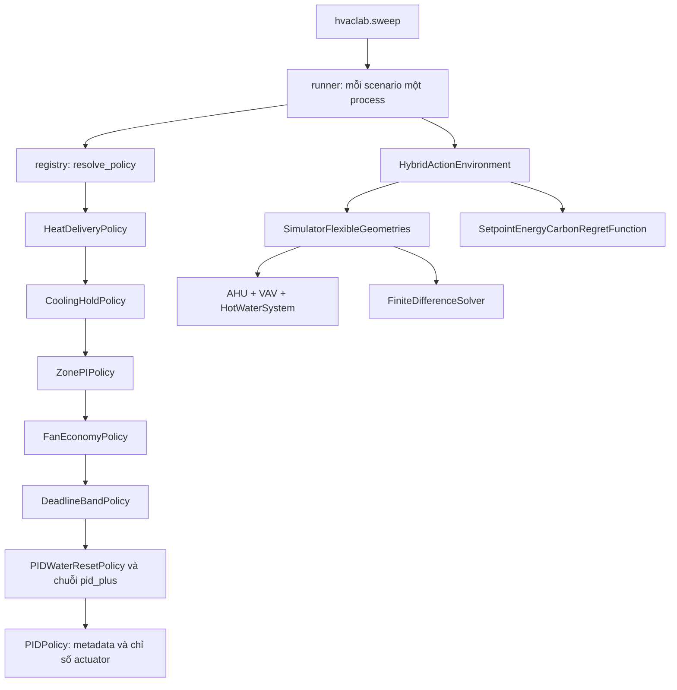

# Heating-mode comfort: kiểm tra và kết quả thí nghiệm

Ngày rà soát: 26/10/2026. Kết quả bên dưới là phép đo local, không phải điểm
Kaggle. Mục tiêu của task là kiểm tra giả thuyết cấp khí cho reheat; chưa chọn
policy mới chỉ dựa vào các scenario được chọn vì đang có comfort kém.

## Luồng mã nguồn liên quan



`get_action()` gọi lớp cha trước rồi sửa action khi trả về: PI ra quyết định
cho VAV trong `_command_zones`; AHU và HWS được chuỗi PID quyết định; fan
clamp, cooling hold và cuối cùng heat delivery sửa action đó. Vì vậy sửa AHU
ở lớp ngoài không tự động tính lại quyết định nước nóng ở lớp trong.

`hvaclab/holdout.py` sinh dev/test riêng; các JSON trong `experiments/runs/`
là sổ kết quả. `hvaclab/submission/build.py` ghép PID và `_final_policy.py`
thành notebook tự chứa. Bản nộp hiện tại tương đương `h_288`; thí nghiệm
`d_*` không tự động đi vào bản nộp.

## Thiết kế phép đo đang được tiếp quản

4 policy × 5 scenario × 8.640 bước = 20 rollout đủ 30 ngày, 6 worker:

| Policy | Điều kiện bật AHU đang nghỉ |
|---|---|
| `d_ctrl` | Không can thiệp; đối chứng tương đương `h_288` |
| `d_heat` | Ít nhất một zone có đầu ra PI âm |
| `d_heat25` | Ít nhất 25% zone có đầu ra PI âm |
| `d_heat50` | Ít nhất 50% zone có đầu ra PI âm |

Khi bật: SAT `+1.0` (305 K), áp suất `-1.0` (sàn chạy 200 Pa), recirculation
`+1.0` (simulator chặn ở 70%). Không thay VAV hay HWS. Chỉ can thiệp trong
cửa sổ PI; AHU đã chạy, kể cả đang bị cooling hold giữ, được giữ nguyên.

| Scenario | Vai trò | Comfort có trọng số của `h_288` |
|---|---|---:|
| `building_train_7/fairbanks_7` | Comfort tệ nhất | 0.055296 |
| `building_train_2/fairbanks_2` | Comfort tệ thứ 2 | 0.044378 |
| `building_train_7/atlanta_8` | Comfort tệ thứ 3 | 0.042664 |
| `building_train_4/denver_2` | Comfort tệ thứ 4 | 0.040181 |
| `building_train_1/fairbanks_1` | Đối chứng lạnh sâu | Xem bảng kết quả |

Đây là **4 scenario comfort tệ nhất + 1 đối chứng lạnh sâu**, không phải đúng
5 scenario comfort tệ nhất. Vị trí thứ 5 trong `h288_full30.json` là
`building_train_5/denver_3` (comfort 0.036395), không có trong batch này.

Lệnh tái hiện:

```powershell
python -m hvaclab.sweep --policies d_ctrl d_heat d_heat25 d_heat50 --scenarios building_train_7/fairbanks_7 building_train_2/fairbanks_2 building_train_7/atlanta_8 building_train_4/denver_2 building_train_1/fairbanks_1 --steps 8640 --workers 6 --out experiments/runs/ablation_heat.json
```

## Phát hiện từ mã nguồn

1. **Giả thuyết ngắt airflow có cơ sở.** `PIDEconomizerPolicy._ahu_error`
   mặc định dùng nhiệt độ trung bình. `PIDWorstZonePolicy.get_action` tắt AHU
   khi lỗi tổng hợp bằng 0, trong khi PI vẫn có thể mở reheat của zone lạnh.
2. **Airflow chưa đủ để khôi phục heat delivery.** HWS run và pump pressure
   đã được tính trước can thiệp. Nếu toàn bộ AHU của vòng cha nghỉ, nước nóng
   vẫn có run=0 và pressure=-1; pump trả áp suất 0, `total_flow_rate=0`, coil
   không nhận nước. Ngay cả khi HWS đang chạy vì cooling ở nơi khác, setpoint
   nước có thể vẫn ở mức thấp nhất 310 K. Mức thấp nhất không đồng nghĩa với
   không có nhiệt; phải tách nó khỏi trạng thái bơm tắt.
3. **Áp suất sàn chưa được chứng minh là đủ tải nhiệt.** VAV giới hạn nhiệt độ
   khí ra ở **308.15 K (35 °C)** theo mặc định. Những ví dụ khí ra 310/320 K
   trong phần giải thích giả thuyết không đạt được với cấu hình này. Giảm
   airflow có thể giảm cả tải khí ngoài lẫn công suất sưởi cực đại.
4. **Ngưỡng đang đếm đầu ra PI, không đếm phòng ngoài comfort band.** `u<0`
   có thể xuất hiện khi phòng vẫn trong band nhưng dưới tâm band, hoặc do
   trạng thái tích phân. Không diễn giải tỷ lệ 25% như tỷ lệ phòng mất comfort.
5. **Cooling hold vẫn có quyền ưu tiên.** Heat delivery bỏ qua AHU đang chạy,
   nên không sửa được trường hợp phòng lạnh dưới AHU đang bị giữ ở lệnh lạnh.
6. **`heat_starts` đếm số lần ghi đè lệnh AHU.** Nó không phải bộ đếm chuyển
   OFF→ON của thiết bị: vòng cha có thể muốn tắt lại ở mỗi bước liên tiếp.

Giữ nguyên các policy `d_*` trong suốt batch để kết quả không trộn nhiều
phiên bản. Một kết quả âm của batch này chỉ bác bỏ cách can thiệp airflow
hiện tại, chưa đủ bác bỏ cơ chế thiếu khí/nước đồng bộ.

## Kiểm tra lại dữ kiện thời tiết

Tính từ CSV chính trong repo, nội suy ở 8.640 thời điểm cách nhau 300 giây,
bắt đầu tại `start_timestamp` trong `config.gin` của mỗi scenario. Không lấy
ngày mặc định trong `config.yaml`, vì gin mới là cấu hình simulator sử dụng.
Kết quả lưu ở `experiments/runs/heating_context.json`.

- Tương quan Pearson giữa nhiệt độ ngoài trung bình và comfort: **−0,781797**.
- `fairbanks_7`: trung bình **6,3966 °C**, thấp nhất **−2,8 °C** trong episode.
- Tương quan là mô tả trên 30 scenario, chưa chứng minh quan hệ nhân quả.

| Nhiệt độ ngoài trung bình | Comfort | Energy + carbon |
|---|---:|---:|
| < 0 °C | 0.034598 | 0.031168 |
| 0 đến < 15 °C | 0.028580 | 0.007290 |
| 15 đến < 25 °C | 0.004637 | 0.006102 |
| ≥ 25 °C | 0.003016 | 0.013443 |

Các đại lượng là trung bình đóng góp có trọng số trên các scenario trong
mỗi nhóm. Các số trên tái hiện dữ kiện của giả thuyết; chúng chưa đo tác dụng
của `d_heat`.

## Kiểm tra tái hiện

`python -m unittest discover -s tests -v`: 7 kiểm tra logic cho đối chứng,
cold outlier, dấu SAT/pressure, ngưỡng inclusive, AHU đã chạy, không có heat
demand, ngoài cửa sổ PI và cooling hold. Chúng dùng metadata giả lập và chạy
chuỗi policy thật, không tác động đến rollout đang chạy.

Probe bổ sung quan sát action thật mà không sửa policy:

```powershell
python -m hvaclab.heat_diagnostics --steps 1440 --out experiments/traces/heat_probe.json
```

Probe 1.440 bước chỉ kiểm tra cơ chế trong 5 ngày đầu; không so điểm của nó
với điểm đủ 8.640 bước. Kết quả số và quyết định của batch được ghi ở phần sau.

Kết quả probe đã lưu tại `experiments/runs/heat_delivery_probe.json`:

| Đại lượng | Số bước |
|---|---:|
| Tổng bước probe | 1.440 |
| Có ít nhất một AHU được ghi đè để cấp khí sưởi | 682 |
| Có ghi đè nhưng HWS vẫn tắt | 479 / 682 = 70,2% |
| Có ghi đè nhưng pump pressure vẫn ở sàn | 479 |
| Có ghi đè nhưng water setpoint vẫn ở sàn | 509 |

Tổng số lệnh ghi đè AHU là 1.958; một bước có thể ghi đè nhiều AHU. Các hàng
trong bảng là bộ đếm bước và có thể chồng lấn, không được cộng chúng lại.
Đây là bằng chứng trực tiếp cho lỗi đồng bộ HWS trong bản thử, không chỉ là
một trường hợp giả lập ở unit test.

Kiểm tra bổ sung: 16 test reward và closed-loop stability đều qua; 112 file
Python không sinh tự động parse được bằng Python 3.12. Parse kiểm tra cú pháp,
không thay thế việc đánh giá hành vi hoặc chứng minh policy tốt hơn.

## Kết quả đủ 20 rollout

Đã hoàn tất: 20/20 rollout, mỗi rollout 8.640 bước, không lỗi. `d_ctrl` khớp chính xác `h_288` trước đó trên cả 5 scenario về return, reward components và occupancy. Sai số lớn nhất khi cộng lại ba thành phần có trọng số là 7.48e-11, dưới ngưỡng kiểm tra 1e-9.

Nguồn: `experiments/runs/ablation_heat.json`. Điểm thấp hơn là tốt hơn; mọi cột comfort/energy/carbon đã nhân trọng số.

| Policy | Score | Giảm score so với đối chứng | Comfort | Energy | Carbon |
|---|---:|---:|---:|---:|---:|
| `d_ctrl` | 0.06122466 | 0.00% | 0.04243831 | 0.00618375 | 0.01260259 |
| `d_heat` | 0.04162332 | 32.02% | 0.01806958 | 0.00753822 | 0.01601552 |
| `d_heat25` | 0.04192630 | 31.52% | 0.01847136 | 0.00751522 | 0.01593972 |
| `d_heat50` | 0.04654731 | 23.97% | 0.02347456 | 0.00743225 | 0.01564050 |

| Scenario | d_ctrl | d_heat | d_heat25 | d_heat50 | Thay đổi score d_heat |
|---|---:|---:|---:|---:|---:|
| `building_train_7/fairbanks_7` | 0.06747863 | 0.02960630 | 0.02960603 | 0.02985534 | -56.12% |
| `building_train_2/fairbanks_2` | 0.05984411 | 0.03410556 | 0.03553103 | 0.05312532 | -43.01% |
| `building_train_7/atlanta_8` | 0.05341082 | 0.02390800 | 0.02385525 | 0.02574735 | -55.24% |
| `building_train_4/denver_2` | 0.04853577 | 0.02034499 | 0.02048746 | 0.02385553 | -58.08% |
| `building_train_1/fairbanks_1` | 0.07685394 | 0.10015175 | 0.10015175 | 0.10015301 | +30.31% |

### Kết luận của batch

- `d_heat` tốt nhất trong nhóm thử: score giảm **32,02%** trên 5 scenario. Trên 4 scenario comfort tệ nhất, trung bình giảm **52,91%** (0.05731733 → 0.02699121).
- Comfort giảm **57,42%**, đồng thời energy + carbon tăng **25,38%**. Lợi ích là mua comfort bằng năng lượng; cả ba hạng mục không cùng cải thiện.
- Đối chứng lạnh sâu `fairbanks_1` tệ hơn **30,31%**; comfort của chính scenario này cũng tệ hơn (0.02967260 → 0.04389474). Ngưỡng 25%/50% không loại được regression này.
- Phép đo hỗ trợ việc AHU nghỉ làm mất khả năng điều khiển zone ở một số chế độ sưởi, nhưng chưa xác định phần đóng góp của airflow, SAT ấm nhất, và HWS chưa đồng bộ. Các actuator được đổi cùng nhau trong một can thiệp.
- **Giữ bản nộp hiện tại là `h_288`.** Chưa thể suy rộng mức giảm 32% sang toàn bộ shipped-30, dev, test hoặc Kaggle. Chưa chạy `d_*` trên các tập đó trong task này.
- Bước thử tiếp theo có cơ sở: đồng bộ HWS run/pressure khi có reheat demand và đo như một biến thể mới; kiểm tra đồng thời regression lạnh sâu và capacity dưới giới hạn discharge 35 °C. Điều kiện điều khiển phải dựa trên trạng thái quan sát được, không dựa trên nhãn thời tiết hoặc id scenario.

Snapshot nguồn lúc batch đang chạy nằm ở `experiments/runs/ablation_heat_provenance.json`. Sau khi batch hoàn tất, chỉ phần giải thích và comment của `heat_delivery.py` được sửa để phản ánh giới hạn discharge và HWS; logic policy đã đo không đổi.
